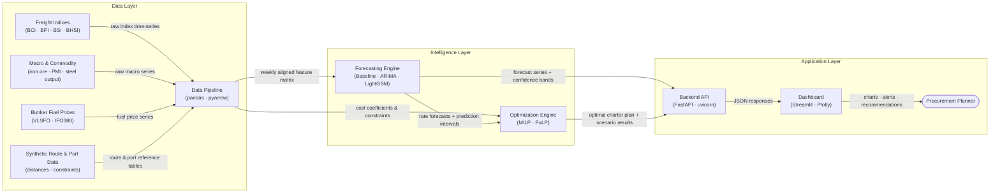

# System Architecture — SIH26006
**Intelligent Freight Forecasting & Chartering Advisory System · SAIL**

---

## Architecture Diagram

---

## Component Descriptions

### 1 · Freight Indices *(BCI, BPI, BSI, BHSI)*
**Input:** Raw daily or weekly index values from Baltic Exchange sub-indices (or proxy sources such as NASDAQ Data Link / Stooq pending license verification).
**Output:** Time-series CSV files partitioned by vessel class and date.
**Tech:** Public market data; manual or API download; stored in `data/raw/`.
Each sub-index tracks the charter market for one vessel class — Capesize (BCI), Panamax (BPI), Supramax (BSI), Handysize (BHSI) — and is the primary forecasting target. The BDI composite is used only as a benchmark signal, not as a direct input.

---

### 2 · Macro & Commodity Prices
**Input:** Iron ore spot price, global manufacturing PMI, China monthly steel output, seaborne dry-bulk trade volumes.
**Output:** Time-series CSV files aligned to weekly frequency.
**Tech:** World Bank Commodity Prices Pink Sheet (monthly), FRED API (daily → resampled), World Steel Association statistics; all freely accessible.
These series serve as exogenous regressors in the forecasting models: freight rates are historically correlated with iron-ore demand, PMI direction, and China's steel cycle.

---

### 3 · Bunker Fuel Prices *(VLSFO, IFO380)*
**Input:** Historical daily bunker fuel prices at major bunkering hubs (Singapore, Rotterdam).
**Output:** Weekly fuel-cost series used in voyage-cost calculations inside the optimization engine.
**Tech:** Ship & Bunker historical data (free web); EIA / FRED as fallback.
Bunker cost is the largest variable operating cost on a bulk voyage and affects the relative economics of different vessel classes and routing choices.

---

### 4 · Synthetic Route & Port Data
**Input:** Port-authority publications (draft, LOA, beam, berth capacity) and sea-distances.org lookups for all origin–destination pairs.
**Output:** Two static reference tables: `port_infrastructure_reference.csv` and `route_distances_reference.csv`.
**Tech:** Manually curated CSV files; no real-time feed. Missing port constraints flagged `NEEDS_VERIFICATION`; never estimated.
These tables act as hard constraints in the optimization engine: a vessel class is excluded from a route if any port dimension limit is violated.

---

### 5 · Data Pipeline
**Input:** Raw files from all four data sources above (different frequencies, units, and formats).
**Output:** A single weekly-aligned feature matrix (Parquet) ready for model training and inference; a separate cost-and-constraint table for the optimizer.
**Tech:** `pandas`, `pyarrow`; scripts in `src/data/` (ingestion) and `src/features/` (transformation, alignment, lag features, rolling statistics).
Key pipeline steps: parse raw downloads → align to ISO week → forward-fill sparse series → compute lag and rolling features → split chronologically into train / validation / test sets to prevent data leakage.

---

### 6 · Forecasting Engine
**Input:** Weekly feature matrix (freight indices, macro regressors, seasonal dummies, lag features).
**Output:** 4-week-ahead point forecasts and 80 % / 95 % prediction intervals for each vessel class; model performance metrics (MAPE, RMSE, coverage).
**Tech:** `statsmodels` (seasonal naïve baseline, SARIMA), `lightgbm` (gradient-boosted trees with quantile regression for intervals), `scikit-learn` (preprocessing, cross-validation).
Three model tiers are maintained in parallel — naïve baseline, ARIMA/SARIMA, and LightGBM — so performance can be compared and the ensemble or best single model selected per vessel class.

---

### 7 · Optimization Engine
**Input:** Rate forecasts + prediction intervals from the Forecasting Engine; cost coefficients (bunker, port dues, canal fees) and hard constraints (port dimensions, vessel class DWT ranges) from the Data Pipeline.
**Output:** Optimal chartering decision (vessel class, charter window, route) and a set of scenario results (e.g., charter now vs. wait 2 weeks, Panamax vs. Capesize split).
**Tech:** `PuLP` (MILP formulation); `scipy.optimize` as fallback for continuous relaxations.
The MILP minimizes total expected freight cost subject to cargo-volume requirements, port-dimension constraints, and forecast uncertainty bounds, while generating alternative scenarios for the planner to compare.

---

### 8 · Backend API
**Input:** HTTP requests from the Dashboard carrying cargo parameters (volume, route, contract duration).
**Output:** JSON responses containing forecast series, vessel recommendations, optimal charter plan, and scenario comparison data.
**Tech:** `FastAPI`, `uvicorn`; three primary endpoints: `POST /forecast`, `POST /optimize`, `POST /scenarios`.
The API decouples the intelligence layer from the front end, allowing the Dashboard and any future integrations (e.g., SAIL's ERP) to consume results independently. All outputs are advisory; no contract actions are triggered.

---

### 9 · Dashboard
**Input:** JSON responses from the Backend API; planner-supplied cargo parameters entered via form inputs.
**Output:** Four interactive views — forecast chart with confidence bands, optimizer recommendation panel, scenario comparison table, and market-insight alerts.
**Tech:** `Streamlit`, `Plotly`.
The dashboard is the sole user-facing interface. It displays simulated or proxy-data results with explicit labels during prototype development. Any value derived from synthetic data is marked `[SIMULATED]` to prevent misinterpretation as verified SAIL savings.

---

### 10 · Procurement Planner *(User)*
**Input:** Dashboard views — freight forecasts, vessel recommendations, risk alerts, and scenario comparisons.
**Output:** A chartering decision communicated through SAIL's existing procurement workflow.
The system is advisory only. The planner reviews all recommendations and retains full decision authority; no automated contract actions are initiated.

---

*Document owner: Team · Diagram version: 1.0 · Last updated: 2026-10-26*
