# System Architecture & Technical Specification

## Intelligent Freight Forecasting & Bulk Cargo Procurement Optimizer
**Project**: SIH26006 · Ministry of Steel · Steel Authority of India Limited (SAIL)  
**Scope**: Inbound Seaborne Metallurgical & Thermal Coal Logistics for East Coast Indian Steel Plants

---

## 1. End-to-End Pipeline Architecture

```mermaid
flowchart TD
    subgraph DataSources["1. Primary Market & Macro Feeds"]
        BDI["Baltic Dry Index (BDI)<br/><i>Weekly Real Index (2012–2026)</i>"]
        BRENT["ICE Brent Crude<br/><i>Weekly Spot ($/bbl)</i>"]
        MACRO["World Bank & FRED<br/><i>Met Coal, Iron Ore, USD/INR</i>"]
        SUBIDX["Baltic Sub-Indices (BCI, BPI, BSI, BHSI)<br/><i>Historical to 2019; Derived post-2019</i>"]
    end

    subgraph Ingestion["2. Data Processing & Adaptation"]
        LOADER["Data Loaders & Cleaners<br/><code>src/data/</code>"]
        SYNTH["Synthetic Route Rate Generator<br/><i>121 Routes · 4 Vessel Classes</i>"]
        ADAPTER["SAIL Enterprise Data Adapter<br/><code>src/data/adapter.py</code><br/><i>(Swappable with Real Fixture CSVs)</i>"]
    end

    subgraph FeatureStore["3. Master Feature Store"]
        MASTER["Master Engineered Dataset<br/><code>data/processed/master.parquet</code><br/><i>41 Macro, Commodity, Momentum & Lag Features</i>"]
    end

    subgraph Forecasting["4. Predictive Analytics Engine"]
        LGBM["LightGBM Quantile Regressors<br/><i>Direct Multi-Step: h ∈ {1, 4, 8, 12} weeks</i><br/><i>Target Quantiles: q10, q50, q90</i>"]
        CONFORMAL["Split-Conformal Calibration<br/><i>Non-Conformity Scoring over Walk-Forward Folds</i><br/><i>Guaranteed 80% Target Interval Coverage</i>"]
        SCENARIOS["Forward Scenario Generator<br/><i>Low (q10), Base (q50), High (q90)</i>"]
    end

    subgraph Optimization["5. Mixed-Integer Linear Programming (MILP)"]
        PU_LP["puLP Optimization Formulation<br/><code>src/optimizer/model.py</code><br/><i>Rolling Horizon T=6 Months</i>"]
        SOLVER["HiGHS / CBC Branch-and-Cut Solver<br/><i>Gap ≤ 1–3% · Time Limit 20–120s</i>"]
        OBJECTIVES["Multi-Scenario Objectives<br/><i>(a) Expected Value: min ∑ w_s Z_s</i><br/><i>(b) Minimax Robust: min max_s Z_s</i>"]
        DECISIONS["Month-1 Commitment & Advisory Plan<br/><i>Origins, Ports, Vessel Class, Mode (Spot/COA/Period)</i>"]
    end

    subgraph Serving["6. API & Serving Layer"]
        FASTAPI["FastAPI REST Backend<br/><code>src/api/app.py</code><br/><i>Endpoints: /forecast, /optimize, /scenarios, /insights</i>"]
        CACHE["Offline Precomputation & Cache Layer<br/><code>data/cache/</code><br/><i>Instant Sub-Second Response Times</i>"]
        LOGGING["Structured Audit Logging<br/><code>logs/api.log</code><br/><i>Per-request timing & error tracing</i>"]
    end

    subgraph UI["7. Decision Dashboard"]
        VITE["React 18 + Vite SPA<br/><code>app/src/</code><br/><i>Executive Inter font + Navy/Teal/Amber Palette</i>"]
        SCREENS["4 Operational Screens<br/><i>1. Market Forecast · 2. Optimizer Plan</i><br/><i>3. Scenario Comparison · 4. Risk Insights</i>"]
    end

    DataSources --> Ingestion
    Ingestion --> FeatureStore
    FeatureStore --> Forecasting
    Forecasting --> Optimization
    Optimization --> Serving
    Serving --> UI
    CACHE <--> Serving
```

---

## 2. Component Technical Deep-Dives

### 2.1 Primary Market & Macro Feeds
The raw ingestion pipeline aggregates public and proxy benchmark data spanning **2012-08-03 to 2026-10-23** (743 weekly observations).
- **Baltic Dry Index (BDI)**: Composite benchmark for seaborne dry bulk freight rates.
- **ICE Brent Crude ($/bbl)**: Benchmark driving maritime Very Low Sulphur Fuel Oil (VLSFO) bunker costs via the calibrated ratio $\text{VLSFO} = \text{Brent} \times 8.5$.
- **Macro & Commodity Drivers**: Weekly USD/INR exchange rates (RBI/FRED) and World Bank Pink Sheet indices (iron ore CFR China, Australian thermal coal, metallurgical coal proxies).
- **Baltic Sub-Indices (BCI, BPI, BSI, BHSI)**: Historical sub-indices are preserved through July 31, 2019. Beyond this cutoff date, sub-indices are derived using fixed historical structural ratios relative to BDI to prevent data leakage during machine learning.

### 2.2 Data Adaptation & Synthetic Generation
- **Synthetic Route Generator (`src/data/synthetic_routes.py`)**: Simulates weekly per-tonne voyage freight rates across **121 feasible maritime triples** $(origin, destination, vessel\_class)$ spanning 7 global export origins, 6 Indian East Coast destination ports, and 4 standardized vessel classes. The formula evaluates round-trip laden and ballast sea time, port dwell days, fuel consumption, port dues, and time-charter hire equivalents.
- **Enterprise Data Adapter (`src/data/adapter.py`)**: Provides a plug-and-play adapter that ingests authentic SAIL charter fixtures (`data/sample/sail_template.csv`), validates schema constraints (parcel sizes, voyage days, freight rates $/MT), and normalizes internal fixture logs to match downstream pipeline requirements.

### 2.3 Master Feature Engineering (`master.parquet`)
The unified weekly dataset compiles **41 predictive features**:
- **Lags & Momentum**: 1-, 4-, 8-, 12-, and 26-week autoregressive lags and percentage changes.
- **Rolling Volatilities & Trends**: 4-, 12-, and 26-week moving averages and rolling standard deviations for freight and bunker indices.
- **Calendar & Monsoon Signals**: Indian monsoon indicator (`is_monsoon`: June–September) capturing severe coastal discharge slowdowns, rainfall demurrage spikes, and seasonal steel demand dips.
- **Strict Leakage Prevention**: All Baltic sub-indices are strictly excluded from predictive feature matrices because post-2019 sub-indices are derived from the target BDI.

### 2.4 Machine Learning Quantile Forecasting Engine
- **Direct Multi-Step Quantile Regression**: Built on LightGBM regressors trained with quantile objective functions $\tau \in \{0.10, 0.50, 0.90\}$ across rolling planning horizons $h \in \{1, 4, 8, 12\}$ weeks.
- **Hyperparameter Architecture**: Shallow decision trees (`num_leaves=15`, `min_child_samples=20`, `learning_rate=0.03`, early stopping=25) regularized against freight volatility overfitting.
- **Split-Conformal Calibration**: Raw quantile regression intervals exhibit empirical undercoverage (55%–70%) on out-of-sample data. The conformalization module computes non-conformity scores on preceding temporal folds, calibrating band widths upwards to guarantee an **80.0% nominal prediction interval coverage** (empirical test coverage: **65.0%–76.2%**).

### 2.5 Multi-Scenario Mixed-Integer Linear Programming (MILP) Optimizer
Formulated in `src/optimizer/model.py` and solved via the open-source **HiGHS** (and CBC) branch-and-cut solvers:
- **Rolling Horizon**: 6 monthly planning stages ($T=6$), where Month-1 decisions are committed while Months 2–6 provide dynamic multi-period inventory and fleet hedging.
- **Decision Dimensions**:
  - Continuous purchase & shipment volumes $x_{m,c,o,p,v,t}$ across charter modes $m \in \{\text{Spot, COA, Period}\}$, cargoes $c$, origins $o$, ports $p$, vessel classes $v$, and months $t$.
  - Discrete voyage counts $n_{m,c,o,p,v,t} \in \mathbb{Z}^+$.
  - Period vessel fleet sizing $k_{v,t} \in \mathbb{Z}^+$ subject to 3-month minimum commitment rules.
  - Port inventory tracking $I_{c,p,t}$, unmet demand slack variables $u_{c,p,t}$, and supplier export allocations.
- **Uncertainty Formulation**:
  - **Expected Value (Mean Plan)**: $\min \sum_{s \in \{\text{low, base, high}\}} w_s Z(s)$ with default risk weights (25% / 50% / 25%).
  - **Minimax Robust Plan**: $\min \max_s Z(s)$ minimizing maximum financial downside in high-freight market regimes.

### 2.6 FastAPI REST API Engine
- **Microservices Layer (`src/api/app.py`)**: Asynchronous REST API serving predictions, scenario runs, baseline analytics, and diagnostic insights.
- **Sub-Second Offline Cache**: Precomputes rolling optimization and scenario runs (`data/cache/`), enabling instantaneous dashboard rendering. When interactive parameter sliders are adjusted, the backend invokes fast-mode solves ($T=3, \text{gap}=5\%, \text{time\_limit}=20\text{s}$).
- **Logging & Observability**: Every incoming endpoint request is intercepted by an asynchronous timing middleware and written to `logs/api.log` with response latency in milliseconds.

### 2.7 Executive Decision Dashboard
Built with **React 18, Vite, Tailwind CSS, and Recharts**:
- **Screen 1 (Forecast)**: Interactive fan charts visualizing calibrated BDI quantile prediction bands ($q_{10}, q_{50}, q_{90}$) across 1 to 12 weeks, route per-tonne conversion calculators, and macroeconomic correlation indicators.
- **Screen 2 (Optimizer)**: Interactive procurement cockpit displaying Month-1 vessel fixture recommendations, cost breakdowns by component, inventory buffer health, and baseline savings.
- **Screen 3 (Scenarios)**: Side-by-side three-column evaluation across Low (Teal), Base (Navy), and High (Amber) market scenarios with linked interactive probability sliders summing to 100%.
- **Screen 4 (Insights & Risk)**: Waterfall savings analysis, rule-based risk alert feed, top feature importance rankings by horizon, and interactive bunker fuel sensitivity what-if simulators.

---

## 3. Known Assumptions & Verification Checklist

The table below compiles every assumption marked `# synthetic` or `# verify` within `config/optimizer_inputs.yaml` and `config/routes.yaml`. These parameters serve as engineering placeholders calibrated from public SAIL filings and must be verified against authentic enterprise contracts prior to live deployment:

| Config File | Section / Parameter | Configured Value | Tag | Engineering Rationale & Description | Enterprise Production Verification Action |
|:---|:---|:---:|:---:|:---|:---|
| `optimizer_inputs.yaml` | `demand_per_month.coking_coal` | 1,000,000 MT/mo | `# synthetic` | Approx. 12 MTPA imported metallurgical coal requirement across SAIL plants | Verify against SAIL Raw Materials Division (RMD) annual import targets |
| `optimizer_inputs.yaml` | `demand_per_month.thermal_coal` | 200,000 MT/mo | `# synthetic` | Approx. 2.4 MTPA imported thermal / PCI blend requirement for captive power | Verify against SAIL captive power plant procurement quotas |
| `optimizer_inputs.yaml` | `port_demand_shares.coking_coal` | Vizag: 0.25, Paradip: 0.25, Gangavaram: 0.20, Dhamra: 0.15, Haldia: 0.10, Krishnapatnam: 0.05 | `# synthetic` | Plant allocation shares based on rail corridor connectivity to RSP, BSL, DSP, ISP | Confirm plant logistics quotas and rake allocation capacities with Indian Railways |
| `optimizer_inputs.yaml` | `port_demand_shares.thermal_coal` | Paradip: 0.30, Vizag: 0.20, Dhamra: 0.20, Gangavaram: 0.15, Haldia: 0.10, Krishnapatnam: 0.05 | `# synthetic` | Regional coal stockyard discharge shares | Align with thermal stockyard throughput allotments |
| `optimizer_inputs.yaml` | `fob_prices.coking_coal` | Hay Point: $220, Newcastle: $210, Hampton Roads: $230, Nacala: $195, Beira: $190, Vanino: $185 | `# synthetic` | Calibrated against Platts Premium Low Vol (PLV) and Tier-2 metallurgical coal indices | Plug in active term-contract and index-linked FOB pricing formulas from suppliers |
| `optimizer_inputs.yaml` | `fob_prices.thermal_coal` | Newcastle: $110, Samarinda: $75 | `# synthetic` | Calibrated against Newcastle 6000 kcal and Indonesian 4200 GAR benchmarks | Input actual supplier FOB contract prices |
| `optimizer_inputs.yaml` | `quality_penalties.coking_coal` | Hay Point: $0, Newcastle: +$8, Hampton Roads: -$5, Nacala: +$12, Beira: +$15, Vanino: +$10 | `# synthetic` / `# verify` | Value-in-Use (ViU) penalties accounting for ash, moisture, CSR, and phosphorus penalties | Input SAIL Research & Development Centre for Iron & Steel (RDCIS) ViU matrix |
| `optimizer_inputs.yaml` | `quality_penalties.thermal_coal` | Newcastle: $0, Samarinda: +$14 | `# synthetic` / `# verify` | Calorific value discount (6000 kcal vs 4200 kcal GAR) | Confirm calorific blending formula with plant blast furnace engineers |
| `optimizer_inputs.yaml` | `supplier_capacity_per_month` | Hay Point: 600k MT, Newcastle: 400k MT, Hampton Roads: 350k MT, Nacala: 300k MT, Beira: 150k MT, Vanino: 250k MT | `# synthetic` | Maximum monthly export allocation by supplier mine and terminal corridor | Verify long-term off-take agreements and supplier volume ceilings |
| `optimizer_inputs.yaml` | `berth_capacity_per_month` | Paradip: 700k MT, Vizag: 600k MT, Gangavaram: 600k MT, Dhamra: 500k MT, Krishnapatnam: 300k MT, Haldia: 250k MT | `# synthetic` | Mechanized coal berth discharge limits across port terminals | Confirm dedicated berth availability and monthly raking capacity |
| `optimizer_inputs.yaml` | `inventory_capacity_per_port` | 800,000 MT | `# synthetic` | Port dedicated raw material stockyard area | Confirm lease boundaries and maximum stockpile stacking limits |
| `optimizer_inputs.yaml` | `initial_inventory_days` | 30.0 Days | `# synthetic` | Minimum strategic plant reserve required at horizon start | Confirm actual current stock on ground from port logistics dashboard |
| `optimizer_inputs.yaml` | `terminal_inventory_days` | 30.0 Days | `# synthetic` | Terminal boundary condition preventing end-of-horizon stock depletion | Confirm required safety buffer targets for subsequent cycles |
| `optimizer_inputs.yaml` | `inventory_holding_cost_usd_per_mt` | Coking: $3.00/MT/mo, Thermal: $1.20/MT/mo | `# synthetic` | Capital cost of money (~12% p.a.) plus stockpile degradation and handling (~1.5% cargo value) | Align with SAIL corporate treasury Weighted Average Cost of Capital (WACC) |
| `optimizer_inputs.yaml` | `coa.min_volume_mt` | 300,000 MT | `# synthetic` | Minimum volume commitment across planning horizon to secure COA terms | Check standard minimum tonnage clauses with shipping lines |
| `optimizer_inputs.yaml` | `coa.discount_rate` | 0.0% | `# verify` | Rate discount relative to 12-week trailing spot rate | Confirm negotiated shipping conference volume discounts |
| `optimizer_inputs.yaml` | `period.min_duration_months` | 3 Months | `# synthetic` | Typical short-term time charter duration (3–6 months) | Review Baltic time-charter market standards for Capesize/Panamax |
| `optimizer_inputs.yaml` | `period.discount_rate` | 0.0% | `# verify` | Discount on period time-charter relative to trailing spot rate | Check broker chartering desk estimates |
| `optimizer_inputs.yaml` | `demurrage.rate_usd_per_day` | $18,000 / day | `# verify` | Standard bulk carrier charterparty demurrage rate | Confirm with active fixture charterparty agreements |
| `optimizer_inputs.yaml` | `demurrage.expected_delay_days` | 1.5 Days | `# synthetic` | Average pre-berthing waiting time at East Coast discharge berths | Extract actual historical anchorage wait times from port logs |
| `optimizer_inputs.yaml` | `bunker.brent_price_usd_per_bbl` | $80.00 / bbl | `# verify` | Baseline benchmark crude oil price | Updated dynamically via live API feed or market quotes |
| `routes.yaml` | Vessel Specifications (DWT, Parcel) | Handysize (35k/30k), Supramax (58k/52k), Panamax (75k/70k), Capesize (170k/155k) | `# verify` | Standard international bulk carrier deadweight and parcel allowances | Verify vessel dimensions against SAIL Shipping division norms |
| `routes.yaml` | Vessel Operating Speeds | Laden: 12.0–13.0 kn; Ballast: 12.5–13.5 kn | `# verify` | Economical cruising speeds under standard weather conditions | Confirm charterparty warranties for eco-speed performance |
| `routes.yaml` | Vessel Fuel Consumption | Sea: 18–48 MT VLSFO/day; Port: 2.5–5.5 MT/day | `# verify` | Daily bunker consumption curves across vessel classes | Verify engine specifications with technical vessel managers |
| `routes.yaml` | Port Cost Dues (Origin & Dest) | $45,000 – $110,000 per vessel call | `# verify` | Port dues, pilotage, tug hire, berth hire, and anchorage fees | Confirm current Port Authority Scale of Rates (SOR) tariffs |
| `routes.yaml` | Channel Draft Limitations | Haldia: 8.5m draft max (Supramax only); Beira: shallow (Supramax only); US East Coast: 50ft (Baby-Cape) | `# verify` | Navigational drafts and lock-gate constraints | Verify latest Notices to Mariners and Port Marine Department circulars |
| `routes.yaml` | Route Distances | 2,250 nm to 10,350 nm | `# verify` | Standard marine nautical distances via standard shipping channels | Confirm waypoints via Admiralty Distance Tables |
| `routes.yaml` | `brent_to_vlsfo_factor` | 8.5 | `# verify` | Metric ton VLSFO cost multiplier vs Brent crude barrel | Calibrate against Singapore / Fujairah bunker spot assessments |
| `routes.yaml` | `index_to_hire.factor` | BCI: 9.07, BPI: 9.00, BSI: 12.64, BHSI: 18.00 | `# verify` | Daily USD time-charter hire conversion per Baltic index point | Confirm with Clarkson / SSY / Baltic Exchange broker assessments |
